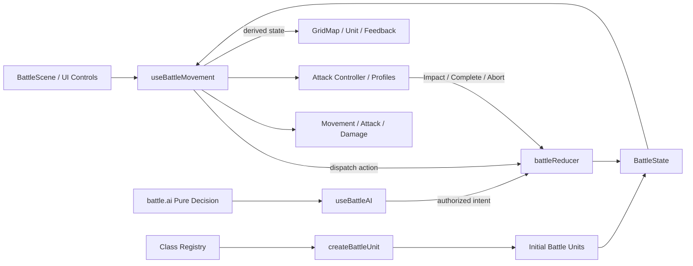
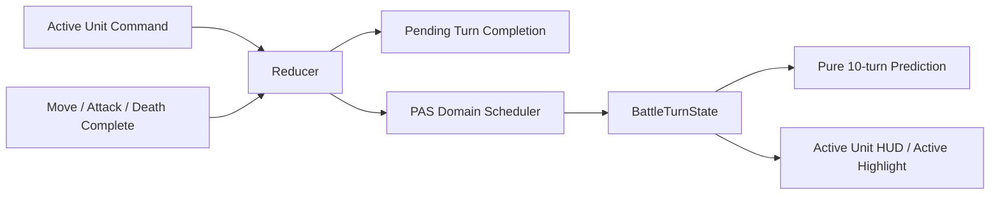
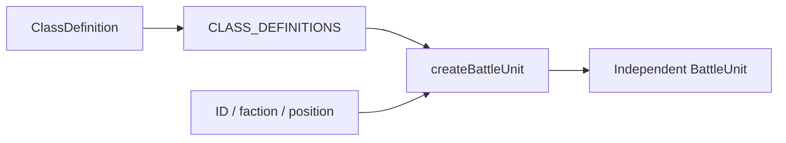
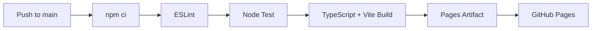

# Software Architecture

## 技術選型

| 類別 | 技術 |
| --- | --- |
| UI | React 19、TypeScript |
| Build | Vite 8 |
| 3D Rendering | Three.js、React Three Fiber、React Three Drei |
| UI Motion / Icons | Motion、Lucide React |
| 狀態管理 | React Hooks、`useReducer` |
| 測試 | Node.js Native Test Runner |
| 品質 | ESLint、TypeScript Build |
| CI/CD | GitHub Actions |
| Hosting | GitHub Pages |
| Package Version Source of Truth | `package.json`、`package-lock.json` |

目前不使用 Redux、Zustand、大型遊戲引擎、後端或外部資料庫；新增技術需事先確認。

## Repository 結構

```text
sword-of-sealing/
├── .github/
│   ├── copilot-instructions.md
│   └── workflows/deploy-pages.yml
├── docs/
├── public/assets/
├── src/
│   ├── components/MainMenu/
│   ├── features/battle/
│   │   ├── components/
│   │   └── hooks/
│   └── game/
│       ├── battle/
│       │   ├── battle.turn.ts
│       │   ├── battle.turn.types.ts
│       │   └── battle.turn.constants.ts
│       ├── end-conditions/
│       │   ├── end-condition.interface.ts
│       │   ├── end-condition.context.ts
│       │   ├── abstract-end-condition.ts
│       │   ├── win-condition.ts
│       │   ├── loss-condition.ts
│       │   ├── win/all-dead.ts
│       │   └── loss/all-dead.ts
│       ├── classes/
│       └── grid/
└── tests/
```

## 分層與資料流



Game Logic 位於 `src/game`，Rendering 位於 `src/features`。UI 可產生 Action 並顯示 Derived State，但不得另行實作戰鬥規則。

## 核心模組

| 模組 | 職責 |
| --- | --- |
| `game/battle/battle.types.ts` | BattleUnit、BattleState、Motion、Attack Result 型別 |
| `game/battle/battle.state.ts` | Reducer、建立與驗證狀態、操作轉換、Undo |
| `game/battle/battle.session.ts` | 以固定 Scenario Configuration 建立初始 BattleState 與對應 Reducer |
| `game/end-conditions/` | EndCondition Contract、唯讀 Context、ANY／ALL Manager、Outcome Resolver 與具體勝敗策略 |
| `game/battle/battle.attack.ts` | 攻擊距離、範圍、合法目標 |
| `game/battle/battle.damage.ts` | 純傷害計算 |
| `game/battle/battle.animation.ts` | Attack Animation Type、職業 Mapping、Profile、純 Timeline |
| `game/battle/battle.death.ts` | Death Profile、1,200 ms Timeline、倒地方向 |
| `game/battle/battle.unit.ts` | Unit Life State 與存活判定 |
| `game/battle/battle.turn.ts` | PAS DES 排程、確定性排序、Turn Completion 與唯讀 Preview |
| `game/battle/battle.turn.types.ts` | Turn Timeline、Pending Completion 與 Preview 型別 |
| `game/battle/battle.turn.constants.ts` | 1000 BU、200 BTU／Round、預覽數量與容差 |
| `game/battle/battle.action.ts` | Turn Action State 初始化、Turn Context 比對與 Combat／Attack 可用性 |
| `game/battle/battle.ai.ts` | 純 Rule-based Tactical AI、穩定 Comparator 與 Movement／Attack Decision |
| `game/battle/battle.ai.gateway.ts` | 從目前 State 導出 Controller Intent、凍結 AI Action 與私有 identity capability 驗證 |
| `game/battle/battle.movement.ts` | 單位移動預算與完成前驗證 |
| `game/battle/occupancy.ts` | 棋格佔位唯一性 |
| `game/battle/obstacles.ts` | 障礙配置與驗證 |
| `game/grid/movement.ts` | Dijkstra、路徑與成本 |
| `game/grid/terrain.*.ts` | 地形資料、型別、成本與顏色 |
| `game/classes/` | 職業型別、Registry、驗證與 Factory |
| `features/battle/hooks/useBattleMovement.ts` | State Hook、Derived State 與 Action 介面 |
| `features/battle/hooks/useBattleAI.ts` | Enemy Active Turn Controller、受控 Intent 提交、Move／Attack Lifecycle 進階與有限 Recovery |
| `features/battle/battleHud.ts` | BattleUnit 到 HUD View Model 的純轉換、資產 URL、資源百分比與正式攻擊範圍縮圖 |
| `features/battle/components/BattleHUD.tsx` | Active Unit 角色資訊、HP／SP、屬性圖示與 Session callback 控制 |
| `features/battle/unitPresentation.ts` | 依 faction 與 PAS Active Unit ID 選擇 overhead label／active indicator 呈現 |
| `features/battle/components/ActiveUnitIndicator.tsx` | 將 active indicator 投影至單位世界座標的 Drei Html 呈現 |
| `features/battle/hooks/useAttackAnimation.ts` | 單一動畫時鐘介面 |
| `features/battle/hooks/attackAnimationControllerLifecycle.ts` | React 與 Frame Harness 共用的 Clock／事件／Abort Lifecycle Runtime |
| `features/battle/components/AttackAnimationController.tsx` | Wind-up／Impact／Recovery 的權威計時與事件派送 |
| `features/battle/components/DeathAnimationController.tsx` | Death ID 獨立時鐘、完成與 System Abort |
| `features/battle/components/DeathParticleEffect.tsx` | 24 顆低成本死亡粒子與清理 |
| `features/battle/components/AttackProjectile.tsx` | 魔法球、箭矢與聖光投射物 |
| `features/battle/components/HitEffect.tsx` / `FloatingDamage.tsx` | 命中特效與 Applied Damage 漂浮數字 |
| `features/battle/components/UnitLabel.tsx` / `unitLabel.utils.ts` | 單一 CanvasTexture／Sprite、HP 視覺過渡與同畫布繪製 |
| `features/battle/BattleScene.tsx` | Canvas、Battle HUD、Result Overlay 與 Hook 整合 |
| `features/battle/components/` | 棋盤、模型、標籤與障礙 Rendering |

`useBattleMovement` 已承擔超出移動的整體戰鬥職責；其重新命名屬於未授權技術債，不應自行重構。

## PAS 與 Individual Turn

`BattleTurnState` 集中保存 `battleTime`、`round`、`turnId`、`activeUnitId` 與每個合格單位的 Remaining Distance／Velocity。PAS 使用均速 Remaining Distance Model 與 DES：只在取得或完成個體回合時推進虛擬 Battle Time，不由現實時間、Renderer 或 `useFrame` 驅動。

純 Domain Functions 負責 AV、Round、最小抵達時間、確定性 Tie-break、同步 Distance 更新與 Preview；`battleReducer` 驗證 Active Unit 與 Turn ID，並獨占 Turn 生命週期。M5-2A 的 Timeline 只投影正式 Active Unit、PAS 預測序列及其 Action Value／time offset；它不排序、不預測新回合、不修改 Turn，也不授予操作權。PAS 目前不提供每單位本輪已行動狀態，UI 不得從陣營、索引或選取推斷。



Attack Complete 或 Post-impact Abort 在存在 DeathMotion 時保留 `PendingTurnCompletion`。最後一個阻擋 Motion 結束後才原子重置 Active Unit Distance、清理舊 Turn 操作上下文並排程下一位。

M4-2 以 `TurnActionState` 取代 M4-1 的 `movementUsedTurnId`，集中保存 Movement Used、Movement Initiation Lock、Combat Action 狀態及 Reserved Attack ID。每個新 Individual Turn 原子建立 `AVAILABLE / AVAILABLE / unlocked` 狀態；Action State 與 `turnId`、Active Unit ID 不符時所有玩家 Turn Command 均為 no-op。

合法 Move Finish 才消耗 Movement Action；Undo 還原位置並清除 Movement Used。確認攻擊先將 Combat Action 設為 `RESERVED`，清除合法 Undo Record 並鎖定後續 Movement Initiation；合法 Impact 同一 Transition 轉為 `CONSUMED`。Pre-impact Abort 只釋放 Reservation 回到 `AVAILABLE`，不解除 Movement Lock；Post-impact Abort 保留 `CONSUMED` 並進入 Pending Turn Completion。UI 與 Hook 的按鈕可用性只讀取共用 Domain Guards，Reducer 執行最終驗證。

Patch 1 對 Guard 邊界做兩項硬化：`canUndoLastMove()` 顯式拒絕已建立 Movement Initiation Lock，即使異常狀態仍保留 `lastMove`；Reducer 的 Confirm Attack 採用與 UI 相同的 `canConfirmAttack()` Domain Guard，再建立 Reservation 與 Damage Snapshot。UI 不授權操作，Reducer 仍以相同 Pure Guard 作最終裁決。

M4-2 已將 TD-017 的 Context Integrity 整合至玩家指令產生與 Reducer Guard。Hook 在指令建立時捕捉 `turnId/unitId`，Animation Lifecycle 仍以不可變 Motion／Attack／Death ID 驗證；延遲 Callback 不會重新讀取下一個 Active Unit。TD-016 的 Scheduler 先計算全域最小 AV，再選擇 Time Epsilon 內候選；Time Epsilon（BTU）與 Distance Epsilon（BU）分開使用。所有 Tie Candidate 的微量距離被歸零，但 Time Epsilon 外的候選保留正距離；非有限值與超出容差的負距離仍明確拋錯。M4-2 已完成 Formal Acceptance；Review 修復、181/181 自動化驗證及 Product Owner Browser Acceptance 證據見 [DEVELOPMENT_STATUS.md](./DEVELOPMENT_STATUS.md) 與 [TECHNICAL_DEBT.md](./TECHNICAL_DEBT.md)。

## M4-3 Enemy AI

`battle.ai.ts` 提供不 Dispatch、不修改 State、不使用隨機或真實時間的 `decideEnemyTurn()`。決策優先直接攻擊，再建立 Move-to-Attack；兩者都不可行時，以可通行路徑至未來攻擊位置的剩餘地形成本判斷 Approach；沒有嚴格改善則 Standby。擊倒、Applied Damage、Initial Order、移動成本、Row／Column 與 Unit ID 的比較順序均由穩定 Comparator 明確定義。

`battle.ai.ts` 只負責純決策。`battle.ai.gateway.ts` 從當前 Battle State 導出 Controller Intent，再建立 frozen AI Action；私有 WeakSet 以物件 identity 授權，單純的 `source: 'ai'` 字串或複製物件不具授權。Reducer 仍重新驗證 Active Enemy、Faction、Turn／Unit Context、Action State、Busy／Pending、目的地、射程、目標與 Lifecycle。玩家 Guard 與敵方 Guard 不共用入口；底層移動、戰鬥及傷害規則共用。

`useBattleAI` 觀察 Active Enemy Turn，呼叫純決策後提交唯一階段 Intent。`BattleState.aiProgress` 保存 Turn-scoped `MOVING`／`ATTACKING` Phase，使 StrictMode 重複 Effect、Movement Finish／Cancel、Pre-/Post-impact Abort 均經 Reducer 狀態機有限推進。AI 移動仍使用既有 Motion ID；攻擊仍使用相同 Attack Reservation、Impact、Confirmed Event 與 Death Barrier。Controller 不直接推進 PAS；Standby 或 Attack Complete 使用既有 Turn Completion Gateway。

M4-3 Patch 1 將 Phase 改為 Durable Contract：Reducer 的 Movement Finish 由 `MOVING` 原子轉為 `MOVE_COMPLETED`；Controller 的純 Next-intent 函式只在後者提交 Attack。此設計允許同一 Turn 多個不同合法 Phase Action，但同一 Phase 的重播仍由 Reducer no-op。Move 完成後以最新位置檢查原目標；失效時可做一次 Direct-target Re-decision，否則有限 Standby。

M4-3 Patch 2 補足 Rendering / Effect 競態邊界。有效 AttackMotion 可能先被 `useFrame` 觀察到，再由 `useEffect` 初始化 `clockRef`；Frame 必須為該 Attack 建立 0ms Clock，而非視為異常 Abort。Patch 3 將 Clock、Impact／Complete event gating 與 deferred cleanup Abort 收入 `AttackAnimationControllerLifecycle`，React component 和受控 Node Frame Harness 共用同一實作；Effect Replay、錯誤 Attack ID 及大 Delta 同幀 Impact／Complete 均有回歸驗證。Damage 仍只在 Reducer `attack-impact` 成功接受後更新。

敵方 AI 的 Pre-impact Abort 與玩家 Abort 有意不同：敵方已進入 Attack 後若動畫於 Impact 前終止，Reducer 清除 Reservation 並 queue 該敵方 Turn Completion，交由既有 Pending Resolver 等待任何阻擋性 Death Motion；玩家 Pre-impact Abort 仍釋放 Reservation 並保留其 Turn。

M4-3 的正式資料流包含 Pure AI Decision Layer、AI Command Gateway、Reducer Authorization Boundary、AI Controller Intent，以及 React Battle Controller。AttackAnimationController 將 R3F `useFrame` 接至 Attack Animation Lifecycle Runtime；Impact、Complete、Abort callbacks 派送至 Reducer。Reducer 是 HP、Attack Motion、Turn State 與 Death Barrier 的唯一正式更新入口；PAS Scheduler 仍由既有 Turn Completion 流程呼叫，不由 AI 或 Renderer 直接推進。

M5-1 Battle HUD 是 `BattleSessionRuntime` 中的 Presentation Layer。`BattleHUD` 接收 Hook 提供的 Active／Selected Unit、可用操作及 Session-owned callbacks；角色資料由 `battleHud.ts` 從正式 `BattleUnit` 投影，HP／SP 與屬性不另行維護。範圍縮圖呼叫 `getAttackableTiles()`，僅供靜態資訊呈現，不建立另一套合法目標或傷害規則；SP 只讀取正式資料，不消耗或產生效果。裝飾層不攔截棋盤 Pointer，僅按鈕與返回主選單連結接收輸入；所有操作仍經既有 Hook／Reducer 驗證。角色立繪依穩定單位 ID 選取，資產 URL 使用 Vite `BASE_URL`。

M5-2A 在 `BattleSessionRuntime` 以本地狀態維護暫態檢視，並記錄檢視發生時的 PAS `turnId`；這不是 `BattleState` 欄位，不取代 `selectedUnitId`，亦不改寫 `turn.activeUnitId`／PAS。回合推進時，舊檢視不再生效，HUD／CG 在新回合首次渲染即顯示正式 Active Unit。共用 Presentation Policy 禁止 MOVE Mode 的世界／Timeline 檢視切換；COMMAND 點擊非 Active Unit 只更新檢視，ATTACK 點擊仍提交正式目標選取。非法 ATTACK 目標由 Reducer 清除 `selectedAttackTargetId`，Cancel Attack 的 Session Boundary 同時回復 Active Unit 檢視。單位失效時由展示 Selector 回退至有效 Active Unit 或存活單位；Restart／Route Remount 會清除此呈現狀態。

`BattleActionRadialMenu` 只在 `displayUnit.id === activeUnit.id`、Active Player 有選取權、COMMAND、未 Busy／Pending 且未結算時顯示。`BattleActionRadialOverlay` 以 Drei `Html` 錨定 Active Unit Group，使用 Camera Projection 追隨移動與 Orbit Controls；投影會避開 viewport 邊界及已量測的 HUD／Timeline Rect，不修改 Camera Controller。Attack／Move／Undo／Standby 使用既有 Hook callback 與 can* Selector；Skill／Item 僅為 disabled 控制項。Timeline 由 `ResizeObserver` 計算完整卡片容量，最多八格且沒有隱藏 Scrollbar。大型 `characterArtUrl` 與 Timeline `portraitUrl` 分離，友軍還原 M5-1 戰鬥 CG、敵方使用肖像。立繪切換以 keyed 節點重播 320ms 入場動畫；Reduced Motion 停用動畫。M5-2A 不修改 Camera Controller、Battle Core、PAS 或 Action Timeline 計算。

TEST-M4-3-01 的 React Controller 整合邊界：

```text
ReactDOM / StrictMode
        |
        v
AttackAnimationController
        |
        v
Controlled R3F useFrame
        |
        v
AttackAnimationControllerLifecycle
        |
        v
Impact / Complete / Abort Callbacks
        |
        v
battleReducer
        |
        v
HP / Attack Motion / Turn State
```

此測試真實掛載 React Controller；Frame Scheduler 使用可控制時序與 delta 的測試替身；Lifecycle Runtime 與 Reducer 不被 Mock，Visual Components 以 Stub 隔離。這是 Node + jsdom 的 Controller／Reducer 整合測試，不涵蓋 WebGL Rendering、視覺驗收或完整 E2E。

M4-3 Patch 3 已納入 Commit `6052c6197588b00c8732f34b7dbda0a3dc696a25`，Gameplay CI Run `44496931887` SUCCESS。M4-3 已正式驗收。M4-4A 已於 2026-11-20 **COMPLETED — FORMALLY ACCEPTED**；Feature Commit `1cce94613791548cc1717942b72d1513487db857`，其正式結案 Repository Commit `41b43c77e849276847c8c643deedd3a7ca0b0747` 的 GitHub Actions Run `44596893220` SUCCESS。M4-4B／M4-4C **COMPLETED — FORMALLY ACCEPTED WITH LIMITATIONS**；M4-4C Addendum 1 **COMPLETED — ACCEPTED**。Verified M4 Formal Closure baseline 為 Commit `b21b36c8b8343865b8abd457cdd70c8b332dfc7b`／GitHub Actions Run [44617918846](https://github.com/uNaXiG/sword-of-sealing/actions/runs/44617918846) SUCCESS，271/271 Tests、6/6 Production Route Integration、Lint、Build 與 Pages Deployment PASS。Product Owner BV-C01～C14 為 14/14 PASS；此驗收先於 VA1，與 Agent 原始 PARTIAL／NOT VERIFIED 結果分開記錄。RV-M4-4B-02 的 GPU Resource Verification 核准移交 TD-010；M4 為 100%、Overall 40%。M5-1 已 **COMPLETED — FORMALLY ACCEPTED**；M5-2A **IMPLEMENTED — PENDING REVIEW**，M5-2B 未開始。

## Battle State 與 Reducer

`BattleState` 集中保存選取、操作模式、移動動畫、單次 Undo 紀錄及攻擊結算。`battleReducer` 驗證 Action，處理過期 `motionId`、生命狀態、佔位、範圍、撤銷條件及狀態轉換，並以不可變方式更新。

正式 Unit 座標在移動動畫完成後才更新。攻擊確認只建立 `PENDING_IMPACT` AttackMotion 與預計 AttackResult；合法 `attack-impact` 才更新 HP，`attack-complete` 清除 AttackMotion，`attack-abort` 依階段保留或不套用傷害。若仍有 DeathMotion，戰鬥操作不會因攻擊收招完成而提前解鎖。

AttackMotion 與 Move Motion 互斥。`BattleState` 保存 Attack ID、雙方座標快照、Animation Type、結算 Phase 及預計結果；逐幀時間只由 Animation Controller 的局部時鐘保存。

Confirmed Impact Event 由 Reducer 於合法 Impact 後建立。Renderer 只消費 `confirmedImpacts` 播放 Floating Damage、Hit Flash／Shake 與 Impact Effect，不再於 Dispatch 前建立傷害回饋。事件包含 Attack ID、位置快照、Animation Type 與 AttackResult，並在回饋播放完成後冪等消費。

Death State 使用 `DeathMotion[]`、`nextDeathId` 與 `defeatedUnits`。致命 Impact 在同一次狀態轉換建立 DeathMotion；死亡完成或 System Abort 後，原子移除 Active Unit、保存 HP 0 的完整 Record 並釋放 Occupancy。`isBattleBusy()` 同時觀察 Move、Attack 及 Death Motion。

## Interface + Registry + Factory



`ClassDefinition` 統一屬性型別，Registry 集中數值與驗證，Factory 建立獨立 HP、SP、座標與戰鬥資料。平衡數值只應透過正式規格變更。

## React Hooks 與 UI

Hook 計算選中單位、可移動格、攻擊範圍、合法目標、距離、Undo／Confirm 可用性，並把 Action 封裝為 callback。`BattleScene` 負責 Canvas、Orthographic Camera、OrbitControls、Battle HUD 與 Result Overlay；HUD 不自行推導戰鬥權限或修改正式 State。

Rendering 座標由 `column/row` 透過 `cellPosition()` 轉換為 Three.js 世界座標。

HUD 只呈現正式 Active Unit 的資料與既有 callback。`unitPresentation.ts` 僅控制 presentation：隱藏我方頭頂名稱／HP 標籤、保留敵方標籤，並依 PAS 的 `activeUnitId` 顯示目前單位指標；不刪除或修改 `BattleUnit` 的 HP／Combat State。`ActiveUnitIndicator` 透過 Drei `Html` 綁定單位世界座標，輸出到 pointer-events-none overlay，避免攔截 Canvas／OrbitControls 輸入；浮動動畫遵守 `prefers-reduced-motion`。目前 `BattleUnit` 沒有狀態效果資料，故 HUD 不建立空容器或虛構效果。這些呈現變更不改 Reducer、PAS、AI、戰鬥規則或 Session Restart Authority。

## 自動化測試

`tests/*.test.mjs` 直接載入 TypeScript 模組，由 Node.js Test Runner 執行。現有測試覆蓋：

- 職業 Registry／Factory／驗證。
- 四種攻擊模式、目標與傷害。
- Reducer 操作、撤銷、待命與失能狀態。
- Attack Confirm → Impact → Complete／Abort、互斥、鎖定、冪等與過期 ID。
- 六種 Animation Profile、Timeline 事件及大 Delta。
- Death Complete／Abort、Dying 佔位、多 DeathMotion 與 Death Record。
- Confirmed Impact Queue、TD-015、無效 Impact 與事件跨 Attack Complete／Unit Removal。
- Unit Label 血槽與填充幾何、比例邊界及 Canvas 繪製呼叫；不取代 WebGL 瀏覽器驗收。
- Dijkstra、地形成本、障礙與佔位。
- Individual Action Economy、Turn Context、Reservation、Abort Recovery 與 Turn Reset。
- PAS Exact-tie、Near-tie、Round Boundary、Preview 一致性及獨立理論 Oracle 長跑。
- Enemy AI 決策排序、Move-to-Attack、Path-cost Approach、Capability Authorization、Replay、Abort Recovery 與 Death Barrier。

## 部署架構



`vite.config.ts` 使用 Base Path `/sword-of-sealing/`。戰場入口使用 `#battle`。非授權任務不得修改 Workflow 或 Base Path。

## 架構原則

- Rendering 不修改正式戰鬥規則。
- 動畫事件須能識別過期或重複事件。
- State transition、成本、範圍與傷害應保持可測試的純邏輯。
- UI 與正式狀態共用規則，避免雙重實作。
- 不引入尚無需求的持久化、後端、狀態庫或引擎。

## M4-4A End Condition Strategy 與 Battle Outcome

`src/game/end-conditions/` 將每個條件實作為獨立 Strategy。`EndCondition` 提供唯讀 `evaluate(BattleConditionContext): boolean` 契約；`WinEndCondition` 與 `LossEndCondition` 的 Outcome metadata，避免把失敗規則放入勝利管理器。`WinCondition`、`LossCondition` 共用 `AbstractEndCondition`，支援非空集合、預設 ANY／ALL 組合與 Runtime 契約驗證。不得以具體類別判斷或集中式 Condition Switch 取代多型。

`BattleConditionContext` 由 Reducer 根據同一份 BattleState 與 Session 初始名冊建立，向策略提供已凍結的初始／現有單位快照、DefeatedUnitRecord、生命狀態及共用陣營全滅查詢。策略看不到可修改的正式 State。全滅需要非空初始陣營名冊，且所有名冊單位都具有正式死亡紀錄；單位暫時離開 Active Units 或 HP 歸零仍在 DYING 都不會被當作已全滅。

Runtime 會複製／凍結 Condition Collection、凍結 Strategy 物件本身，並提供唯讀 Context；這些保護不等同通用深層不可變性。Concrete Strategy 作者必須驗證 Constructor Configuration，並為已知資料結構建立獨立快照；巢狀物件及陣列須逐層複製並按其 schema 凍結，不得對任意外部物件執行無限制遞迴 Freeze。`Object.freeze()` 不會凍結 Private Fields、Closure 內部狀態，亦不會使 Map／Set 的內容唯讀；Strategy 不得保留可由外部變更的設定參照，`evaluate()` 必須保持同步、純且無副作用。Test-only Nested Configuration Strategy 以明確欄位快照示範此責任模式。

Production `useBattleMovement` 以穩定的 `useState` initializer 建立 `createBattleSession()`，明確提供 `WinCondition([new WinAllDead()])` 與 `LossCondition([new LossAllDead()])`。Session 建立初始 BattleState 與閉包式 `createBattleReducer()`；Condition Manager、策略與初始名冊由 Reducer closure 持有，不存入 BattleState。BattleState 只存 `outcome: null | 'VICTORY' | 'DEFEAT'`，因此 Save／Serialization 不需序列化 Class Instance；M4-4B Restart 建立新 Session 即可取得 ACTIVE 與新的條件實例。未配置條件的 `battleReducer` 保留為舊測試／相容入口；Production Battle Scene 不使用該入口，而是明確注入 Session Configuration。

Battle Core 只依賴 Condition Manager／Context／Resolver Contract，不 import `win/all-dead` 或 `loss/all-dead`。Outcome Resolver 對單一 Context 評估 Win 與 Loss，固定 DEFEAT 優先。Outcome Evaluation Trigger Contract 明確限定：Session 初始化不評估條件，初始 Outcome 保持 ACTIVE；若初始條件已成立，會等到第一個合法、安全的判定觸發才結算，不依賴無效 Action。判定觸發包括有效 Move Finish／Cancel、可接受的 Attack／Death Lifecycle Completion，以及 PAS 推進前的合法回合完成檢查。Attack Impact 仍受 Attack Motion／Combat Reservation 保護，會等 Attack／Death Barrier 完成後才評估。一般 UI 選取／模式操作、無效或未授權 Action、過期／重複 Callback 不觸發 Outcome Evaluation。Pending Turn Completion 在排程 PAS 前先檢查條件；終局原子清除 Pending Turn、Turn Action、AI Progress 與選取，不推進下一 Turn；DefeatedUnitRecord 和已結算戰鬥結果保留。終局 Reducer Guard 與 AI Gateway Guard 阻止所有新命令及晚到 Callback 改寫 Outcome。

### 新增 Condition 的擴充流程

1. 在 `win/` 或 `loss/` 新增一個實作正確 Outcome 類別的 Concrete Strategy；驗證輸入並以明確 schema 快照／凍結設定，讓 `evaluate()` 只依賴 Context。
2. 為策略及邊界語意新增測試；必要時使用 Test-only Strategy 驗證參數化與組合，不將其加入 Production。
3. 由指定 Battle Scenario 建立對應 Win／Loss Manager，透過 `createBattleSession()` 注入；不修改 Reducer 的勝敗分支。
4. 若需新的領域資料，先擴充唯讀 Context／Battle State 的正式契約；不可在 Strategy 私下累積跨 Turn 進度。

未來可新增 `GoToDestination`、`BossDead`、`NpcDead` 或 `OverRounds` 類型的策略，但這些僅為架構例，不代表已實作或已確認其遊戲語意。

M4-4A 於 2026-11-20 正式結案；Strategy、Dependency Injection、Configuration Immutability、Battle Session、Outcome Trigger Boundary 與終局生命週期契約如上。

### M4-4B Session Host、Runtime 與 Restart

`BattleScene` 是外層組合邊界，`BattleSessionHost` 持有單調遞增的 Generation，並將它作為 `BattleSessionRuntime` 的 React `key`。Restart Handler 捕捉建立時的 Generation；Host 只在來源值仍為目前 Generation 時遞增，重複或過期請求不會再建立 Session。State Updater 為純函式，不以可轉送舊 Callback 的 mutable dispatch ref 替換目前 Session。

`BattleSessionRuntime` 是單場戰鬥所有權邊界，包含 `useBattleMovement`、Session Reducer／Dispatch、AI Hook、Attack／Death Animation Hooks、Canvas／Camera／OrbitControls、Controllers、Hover 與其他暫態 UI 狀態。Restart 以 Keyed Remount 卸載舊 Runtime，並透過 `createBattleScenarioSession()` 重新執行同一 Scenario 初始化；該 Factory 明確注入 Win／Loss AllDead Conditions，`createBattleSession()` 為每個 Session 複製 Unit、Obstacle 與初始名冊資料。既有 Session 不從終局狀態倒推初始值。

動畫及玩家 Callback 閉包持有建立當下 Session 的 Dispatch；AI Effect 同樣以該 Session 的 State／Dispatch 運作。即使各 Session 重新從相同 Motion／Attack／Death／Impact ID 起算，舊 Callback 仍只派送到舊 Reducer，不能修改新 Battle State。卸載會清除 Controller Frame Subscription 與各 Runtime Hook／Ref；目前 `useBattleAI` 只同步派送，沒有 Timer。測試證明 Frame Subscription 清理及 Session Dispatch 隔離；底層 WebGL/GPU 資源釋放未由 DOM 數量推定，也未宣稱完成壓力驗證。AI Capability Isolation 目前建立於 Runtime Dispatch Ownership，不是底層 Capability Session Binding；不得宣稱後者已實作或完成驗證。

`BattleResultOverlay` 是只接收正式 Outcome 與 Restart Callback 的 Presentation Component。原生 Modal Dialog 在終局後以 `showModal()` 開啟並將 Focus 移至 Restart；它不讀取 HP、死亡動畫或 Unit Count，也不呼叫 Reducer、AI 或 Condition Strategy。Outcome Terminal Guard 與 Motion／Reservation／Pre-PAS Resolution 仍完全由 M4-4A Battle Core 負責。

M4-4B 的目前 Scenario Factory 可由未來專案端選擇不同正式 Scenario 設定，但通用 Scenario Registry、Save／Load Serialization、Round Limit Semantics 及其他戰役設定尚未實作。M4-4B 為 **COMPLETED — FORMALLY ACCEPTED WITH LIMITATIONS**；Architecture Review APPROVED、Independent Code Review APPROVED WITH LIMITATIONS、Product Owner Acceptance APPROVED。M4-4 Formal Closure 接受 GPU／資源驗證限制並將 RV-M4-4B-02 延後至 TD-010；Agent 原始 Browser PARTIAL／NOT VERIFIED 結果仍獨立保留。

M4-4C 已完成以下驗證項目處置；這些原始 RV 是待驗證項目而非已確認缺陷：

- **RV-M4-4B-01 — CLOSED — VERIFIED**：Production Route Integration 覆蓋 Route 進入／離開／重入、終局 Overlay unmount 與 Runtime cleanup。
- **RV-M4-4B-02 — PARTIAL — DEFERRED TO TD-010**：Identity-mapped Context Loss 與 final Canvas observation 已記錄；`renderer.info.memory`、GPU Disposal 與長時間資源穩定性仍未驗證。
- **RV-M4-4B-03 — CLOSED — VERIFIED**：Production Runtime wiring 的 Session callback isolation、Outcome／Restart integration 有 6/6 測試證據；WebGL／視覺替身範圍維持明確。

RC-M4-4B-07 **ACCEPTED WITH LIMITATIONS**；RC-M4-4B-08 **CLOSED**。M4 Formal Closure 詳見 [DEVELOPMENT_STATUS.md](./DEVELOPMENT_STATUS.md)。

M4-4C 已執行部分 Final Regression 與 Lifecycle Verification，但不視為階段結案。正式 Route 由 App 的 hash listener 切換；`BattleSessionRuntime` 仍是 Session／Reducer Dispatch／AI／Animation／Canvas 的所有權邊界，離開 Route 會卸載 Runtime，重新進入會建立新 Session。六項 Production React Integration Tests 以正式 App、BattleScene、Session Host、Scenario Factory、Reducer 與 Controllers 驗證 Route 重入、舊 Session Callback、Victory／Defeat Overlay Route unmount 與 Outcome／Restart；測試只替換 WebGL Surface、Drei 元件及純視覺輸出，並以測試轉換量測 Frame Callback 與 Canvas 數量，不注入正式 Runtime Counter。

Controller callback closure 綁定建立當時的 Session Dispatch；測試使用相同 Unit／Turn／Motion／Attack／Death／Impact IDs 重入後重播舊 Callback，確認新 Session 不變。StrictMode 下 App Route Listener 與 Frame Subscription 數量受測；十次有效 Restart 逐次檢查 Generation、初始 Session、舊 callback、Controller cleanup 與穩定工作數量。測試亦追蹤 Route／Unmount 期間的 `queueMicrotask` scheduled／completed／pending 數量；Production Battle Runtime 未使用 `setTimeout`／`setInterval`，AI Effect 同步派送。Attack／Death Outcome 仍由正式 Reducer Barrier 決定。這些證據不改變 AI Capability Isolation 的既有界線：安全性來自 Runtime Dispatch Ownership，不宣稱底層 Capability Session Binding。

Resource Ownership 依元件責任處理：R3F Canvas Root unmount 負責其 Renderer lifecycle；Drei OrbitControls 清理其 Listener 並 dispose 控制器；Death Particle Geometry、Floating Damage CanvasTexture 與 Unit Label CanvasTexture 由各自擁有者在 Effect cleanup dispose。這些 source／dependency inspection 與測試用 Frame／Canvas 計數不等同完整 GPU 資源量測。VA1 記錄 2 次 warm-up、10 次量測及額外 renderer probe；initial C1/G1 與新建 C2/G2～C14/G14 共 14 個 Context 均觀察到對應 Context Loss，無 Restore event。最後返回 Menu 並等待 1.5 秒後為 0 個連接 Canvas；此結果不等同 Renderer／GPU 資源已釋放。只讀 Probe 未取得有效 `renderer.info.memory`；詳細樣本見 [DEVELOPMENT_STATUS.md](./DEVELOPMENT_STATUS.md)。BV-C13 的 Agent 結果仍 PARTIAL；PO BV-C13 14/14 acceptance table 屬 VA1 前獨立功能驗收。RV-M4-4B-02 與 AC-C25～C28 **PARTIAL — APPROVED DEFERRAL TO TD-010**；M4-4C 與 M4 均已正式結案（含限制），M4 100%、Overall 40%。
