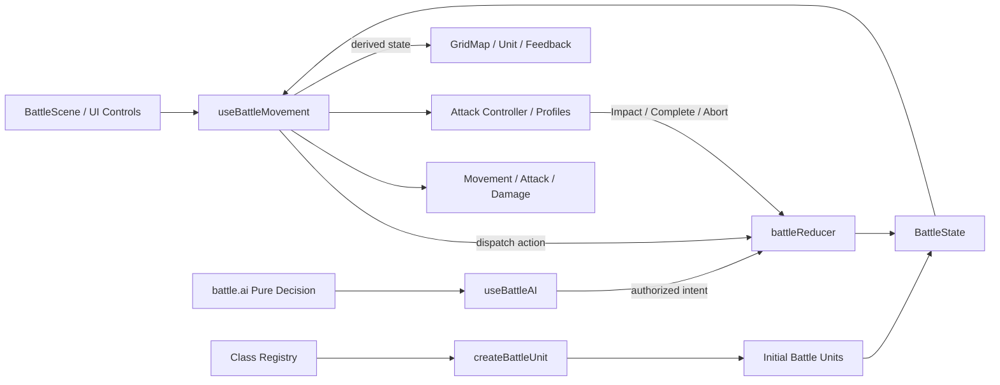
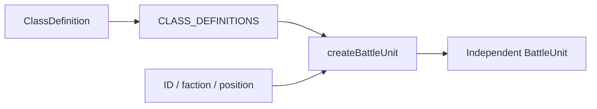
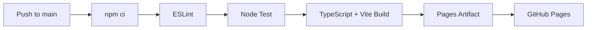

# Software Architecture

## 技術選型

| 類別 | 技術 |
| --- | --- |
| UI | React 19、TypeScript |
| Build | Vite 8 |
| 3D Rendering | Three.js、React Three Fiber、React Three Drei |
| UI Motion / Icons | Motion、Lucide React |
| 狀態管理 | React Hooks、`useReducer` |
| 測試 | Node.js Native Test Runner |
| 品質 | ESLint、TypeScript Build |
| CI/CD | GitHub Actions |
| Hosting | GitHub Pages |
| Package Version Source of Truth | `package.json`、`package-lock.json` |

目前不使用 Redux、Zustand、大型遊戲引擎、後端或外部資料庫；新增技術需事先確認。

## Repository 結構

```text
sword-of-sealing/
├── .github/
│   ├── copilot-instructions.md
│   └── workflows/deploy-pages.yml
├── docs/
├── public/assets/
├── src/
│   ├── components/MainMenu/
│   ├── features/battle/
│   │   ├── components/
│   │   └── hooks/
│   └── game/
│       ├── battle/
│       │   ├── battle.turn.ts
│       │   ├── battle.turn.types.ts
│       │   └── battle.turn.constants.ts
│       ├── classes/
│       └── grid/
└── tests/
```

## 分層與資料流



Game Logic 位於 `src/game`，Rendering 位於 `src/features`。UI 可產生 Action 並顯示 Derived State，但不得另行實作戰鬥規則。

## 核心模組

| 模組 | 職責 |
| --- | --- |
| `game/battle/battle.types.ts` | BattleUnit、BattleState、Motion、Attack Result 型別 |
| `game/battle/battle.state.ts` | Reducer、建立與驗證狀態、操作轉換、Undo |
| `game/battle/battle.attack.ts` | 攻擊距離、範圍、合法目標 |
| `game/battle/battle.damage.ts` | 純傷害計算 |
| `game/battle/battle.animation.ts` | Attack Animation Type、職業 Mapping、Profile、純 Timeline |
| `game/battle/battle.death.ts` | Death Profile、1,200 ms Timeline、倒地方向 |
| `game/battle/battle.unit.ts` | Unit Life State 與存活判定 |
| `game/battle/battle.turn.ts` | PAS DES 排程、確定性排序、Turn Completion 與唯讀 Preview |
| `game/battle/battle.turn.types.ts` | Turn Timeline、Pending Completion 與 Preview 型別 |
| `game/battle/battle.turn.constants.ts` | 1000 BU、200 BTU／Round、預覽數量與容差 |
| `game/battle/battle.action.ts` | Turn Action State 初始化、Turn Context 比對與 Combat／Attack 可用性 |
| `game/battle/battle.ai.ts` | 純 Rule-based Tactical AI、穩定 Comparator、Movement／Attack Decision 與 AI Capability Action |
| `game/battle/battle.movement.ts` | 單位移動預算與完成前驗證 |
| `game/battle/occupancy.ts` | 棋格佔位唯一性 |
| `game/battle/obstacles.ts` | 障礙配置與驗證 |
| `game/grid/movement.ts` | Dijkstra、路徑與成本 |
| `game/grid/terrain.*.ts` | 地形資料、型別、成本與顏色 |
| `game/classes/` | 職業型別、Registry、驗證與 Factory |
| `features/battle/hooks/useBattleMovement.ts` | State Hook、Derived State 與 Action 介面 |
| `features/battle/hooks/useBattleAI.ts` | Enemy Active Turn Controller、受控 Intent 提交、Move／Attack Lifecycle 進階與有限 Recovery |
| `features/battle/components/BattleTurnHUD.tsx` | Round、Battle Time、Turn ID 與 Active Unit HUD |
| `features/battle/components/TurnOrderTimeline.tsx` | Active Unit 與未來 10 次唯讀行動預覽 |
| `features/battle/hooks/useAttackAnimation.ts` | 單一動畫時鐘介面 |
| `features/battle/components/AttackAnimationController.tsx` | Wind-up／Impact／Recovery 的權威計時與事件派送 |
| `features/battle/components/DeathAnimationController.tsx` | Death ID 獨立時鐘、完成與 System Abort |
| `features/battle/components/DeathParticleEffect.tsx` | 24 顆低成本死亡粒子與清理 |
| `features/battle/components/AttackProjectile.tsx` | 魔法球、箭矢與聖光投射物 |
| `features/battle/components/HitEffect.tsx` / `FloatingDamage.tsx` | 命中特效與 Applied Damage 漂浮數字 |
| `features/battle/components/UnitLabel.tsx` / `unitLabel.utils.ts` | 單一 CanvasTexture／Sprite、HP 視覺過渡與同畫布繪製 |
| `features/battle/BattleScene.tsx` | Canvas、UI 與 Hook 整合 |
| `features/battle/components/` | 棋盤、模型、標籤與障礙 Rendering |

`useBattleMovement` 已承擔超出移動的整體戰鬥職責；其重新命名屬於未授權技術債，不應自行重構。

## PAS 與 Individual Turn

`BattleTurnState` 集中保存 `battleTime`、`round`、`turnId`、`activeUnitId` 與每個合格單位的 Remaining Distance／Velocity。PAS 使用均速 Remaining Distance Model 與 DES：只在取得或完成個體回合時推進虛擬 Battle Time，不由現實時間、Renderer 或 `useFrame` 驅動。

純 Domain Functions 負責 AV、Round、最小抵達時間、確定性 Tie-break、同步 Distance 更新與 Preview；`battleReducer` 驗證 Active Unit 與 Turn ID，並獨占 Turn 生命週期。Renderer 只顯示 Derived HUD／Timeline，點擊預覽不授予操作權。


Attack Complete 或 Post-impact Abort 在存在 DeathMotion 時保留 `PendingTurnCompletion`。最後一個阻擋 Motion 結束後才原子重置 Active Unit Distance、清理舊 Turn 操作上下文並排程下一位。

M4-2 以 `TurnActionState` 取代 M4-1 的 `movementUsedTurnId`，集中保存 Movement Used、Movement Initiation Lock、Combat Action 狀態及 Reserved Attack ID。每個新 Individual Turn 原子建立 `AVAILABLE / AVAILABLE / unlocked` 狀態；Action State 與 `turnId`、Active Unit ID 不符時所有玩家 Turn Command 均為 no-op。

合法 Move Finish 才消耗 Movement Action；Undo 還原位置並清除 Movement Used。確認攻擊先將 Combat Action 設為 `RESERVED`，清除合法 Undo Record 並鎖定後續 Movement Initiation；合法 Impact 同一 Transition 轉為 `CONSUMED`。Pre-impact Abort 只釋放 Reservation 回到 `AVAILABLE`，不解除 Movement Lock；Post-impact Abort 保留 `CONSUMED` 並進入 Pending Turn Completion。UI 與 Hook 的按鈕可用性只讀取共用 Domain Guards，Reducer 執行最終驗證。

Patch 1 對 Guard 邊界做兩項硬化：`canUndoLastMove()` 顯式拒絕已建立 Movement Initiation Lock，即使異常狀態仍保留 `lastMove`；Reducer 的 Confirm Attack 採用與 UI 相同的 `canConfirmAttack()` Domain Guard，再建立 Reservation 與 Damage Snapshot。UI 不授權操作，Reducer 仍以相同 Pure Guard 作最終裁決。

M4-2 已將 TD-017 的 Context Integrity 整合至玩家指令產生與 Reducer Guard。Hook 在指令建立時捕捉 `turnId/unitId`，Animation Lifecycle 仍以不可變 Motion／Attack／Death ID 驗證；延遲 Callback 不會重新讀取下一個 Active Unit。TD-016 的 Scheduler 先計算全域最小 AV，再選擇 Time Epsilon 內候選；Time Epsilon（BTU）與 Distance Epsilon（BU）分開使用。所有 Tie Candidate 的微量距離被歸零，但 Time Epsilon 外的候選保留正距離；非有限值與超出容差的負距離仍明確拋錯。M4-2 已完成 Formal Acceptance；Review 修復、181/181 自動化驗證及 Product Owner Browser Acceptance 證據見 [DEVELOPMENT_STATUS.md](./DEVELOPMENT_STATUS.md) 與 [TECHNICAL_DEBT.md](./TECHNICAL_DEBT.md)。

## M4-3 Enemy AI

`battle.ai.ts` 提供不 Dispatch、不修改 State、不使用隨機或真實時間的 `decideEnemyTurn()`。決策優先直接攻擊，再建立 Move-to-Attack；兩者都不可行時，以可通行路徑至未來攻擊位置的剩餘地形成本判斷 Approach；沒有嚴格改善則 Standby。擊倒、Applied Damage、Initial Order、移動成本、Row／Column 與 Unit ID 的比較順序均由穩定 Comparator 明確定義。

AI Controller 只可透過 `createAIAction()` 建立具有模組私有 Capability 的 Intent。單純的 `source: 'ai'` 字串不具授權。Reducer 仍重新驗證 Active Enemy、Faction、Turn／Unit Context、Action State、Busy／Pending、目的地、射程、目標與 Idempotency。玩家 Guard 與敵方 Guard 不共用入口；底層移動、戰鬥及傷害規則共用。

`useBattleAI` 觀察 Active Enemy Turn，呼叫純決策後提交唯一階段 Intent。`BattleState.aiProgress` 保存 Turn-scoped `MOVING`／`ATTACKING` Phase，使 StrictMode 重複 Effect、Movement Finish／Cancel、Pre-/Post-impact Abort 均經 Reducer 狀態機有限推進。AI 移動仍使用既有 Motion ID；攻擊仍使用相同 Attack Reservation、Impact、Confirmed Event 與 Death Barrier。Controller 不直接推進 PAS；Standby 或 Attack Complete 使用既有 Turn Completion Gateway。

M4-3 Patch 1 將 Phase 改為 Durable Contract：Reducer 的 Movement Finish 由 `MOVING` 原子轉為 `MOVE_COMPLETED`；Controller 的純 Next-intent 函式只在後者提交 Attack。此設計允許同一 Turn 多個不同合法 Phase Action，但同一 Phase 的重播仍由 Reducer no-op。Move 完成後以最新位置檢查原目標；失效時可做一次 Direct-target Re-decision，否則有限 Standby。

M4-3 Patch 2 補足 Rendering / Effect 競態邊界。有效 AttackMotion 可能先被 `useFrame` 觀察到，再由 `useEffect` 初始化 `clockRef`；Frame 必須以純 Helper 為該 Attack 建立 0ms Clock，而非視為異常 Abort。Clock ID 必須吻合；非法 Delta 或已有不同 Attack ID 的 Clock 仍走 Abort／Stale Guard。Damage 仍只在 Reducer `attack-impact` 成功接受後更新。

沒有存活玩家與敵人的對戰時，Controller 進入穩定非執行狀態，不建立 M4-4 Outcome 或重複排程。M4-3 已實作並納入 Commit `a912457ae7eb159bd7f5411217f8548e30956e67`，210/210 Automated Verification、Lint、Production Build、GitHub CI 與主要 Product Owner Browser Acceptance 已確認；Architecture Review、Code Review 與 Formal Closure 仍為 PENDING，M4 完成度維持 50%。Patch 2 已修正 AttackMotion 先進入 Frame、`useEffect` 尚未初始化 Clock 的競態；只有合法 Impact 可更新 HP。

## Battle State 與 Reducer

`BattleState` 集中保存選取、操作模式、移動動畫、單次 Undo 紀錄及攻擊結算。`battleReducer` 驗證 Action，處理過期 `motionId`、生命狀態、佔位、範圍、撤銷條件及狀態轉換，並以不可變方式更新。

正式 Unit 座標在移動動畫完成後才更新。攻擊確認只建立 `PENDING_IMPACT` AttackMotion 與預計 AttackResult；合法 `attack-impact` 才更新 HP，`attack-complete` 清除 AttackMotion，`attack-abort` 依階段保留或不套用傷害。若仍有 DeathMotion，戰鬥操作不會因攻擊收招完成而提前解鎖。

AttackMotion 與 Move Motion 互斥。`BattleState` 保存 Attack ID、雙方座標快照、Animation Type、結算 Phase 及預計結果；逐幀時間只由 Animation Controller 的局部時鐘保存。

Confirmed Impact Event 由 Reducer 於合法 Impact 後建立。Renderer 只消費 `confirmedImpacts` 播放 Floating Damage、Hit Flash／Shake 與 Impact Effect，不再於 Dispatch 前建立傷害回饋。事件包含 Attack ID、位置快照、Animation Type 與 AttackResult，並在回饋播放完成後冪等消費。

Death State 使用 `DeathMotion[]`、`nextDeathId` 與 `defeatedUnits`。致命 Impact 在同一次狀態轉換建立 DeathMotion；死亡完成或 System Abort 後，原子移除 Active Unit、保存 HP 0 的完整 Record 並釋放 Occupancy。`isBattleBusy()` 同時觀察 Move、Attack 及 Death Motion。

## Interface + Registry + Factory



`ClassDefinition` 統一屬性型別，Registry 集中數值與驗證，Factory 建立獨立 HP、SP、座標與戰鬥資料。平衡數值只應透過正式規格變更。

## React Hooks 與 UI

Hook 計算選中單位、可移動格、攻擊範圍、合法目標、距離、Undo／Confirm 可用性，並把 Action 封裝為 callback。`BattleScene` 負責 Canvas、Orthographic Camera、OrbitControls 與行動選單。

Rendering 座標由 `column/row` 透過 `cellPosition()` 轉換為 Three.js 世界座標。

## 自動化測試

`tests/*.test.mjs` 直接載入 TypeScript 模組，由 Node.js Test Runner 執行。現有測試覆蓋：

- 職業 Registry／Factory／驗證。
- 四種攻擊模式、目標與傷害。
- Reducer 操作、撤銷、待命與失能狀態。
- Attack Confirm → Impact → Complete／Abort、互斥、鎖定、冪等與過期 ID。
- 六種 Animation Profile、Timeline 事件及大 Delta。
- Death Complete／Abort、Dying 佔位、多 DeathMotion 與 Death Record。
- Confirmed Impact Queue、TD-015、無效 Impact 與事件跨 Attack Complete／Unit Removal。
- Unit Label 血槽與填充幾何、比例邊界及 Canvas 繪製呼叫；不取代 WebGL 瀏覽器驗收。
- Dijkstra、地形成本、障礙與佔位。
- Individual Action Economy、Turn Context、Reservation、Abort Recovery 與 Turn Reset。
- PAS Exact-tie、Near-tie、Round Boundary、Preview 一致性及獨立理論 Oracle 長跑。
- Enemy AI 決策排序、Move-to-Attack、Path-cost Approach、Capability Authorization、Replay、Abort Recovery 與 Death Barrier。

## 部署架構



`vite.config.ts` 使用 Base Path `/sword-of-sealing/`。戰場入口使用 `#battle`。非授權任務不得修改 Workflow 或 Base Path。

## 架構原則

- Rendering 不修改正式戰鬥規則。
- 動畫事件須能識別過期或重複事件。
- State transition、成本、範圍與傷害應保持可測試的純邏輯。
- UI 與正式狀態共用規則，避免雙重實作。
- 不引入尚無需求的持久化、後端、狀態庫或引擎。
